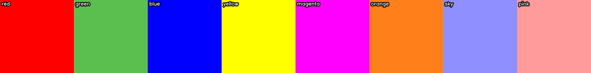
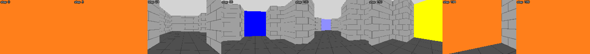
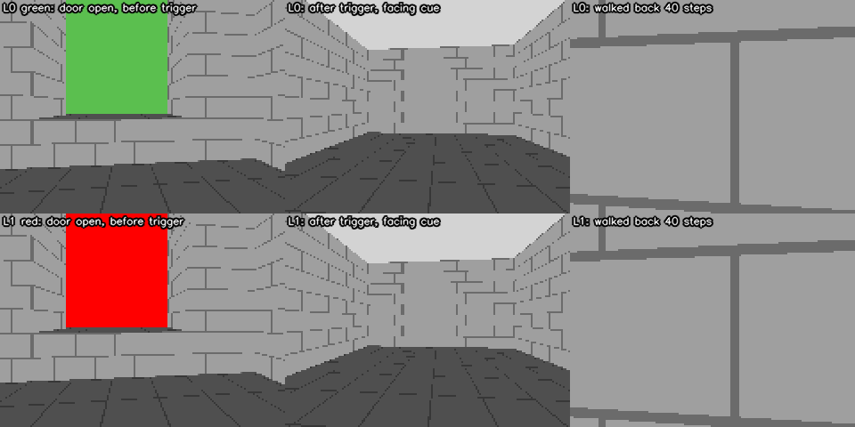

# VizDoom MultiRoomColorGoal

Среда для проверки **памяти** агента в 3D-лабиринте (VizDoom) с настраиваемым
**числом** и **размером** комнат.

Агент появляется в цветной *комнате-подсказке*. Её цвет говорит, в какую из
нескольких комнат-кандидатов нужно войти. Выход из комнаты-подсказки — это
спуск со ступеньки, на которую нельзя забраться обратно, а через два тайла за
спиной агента закрывается дверь. Дальше агент идёт по серым коридорам и видит
цветные комнаты-кандидаты, но саму подсказку увидеть уже не может. Вход в
комнату нужного цвета — успех, вход в любую другую цветную комнату — ошибка.



*Первое наблюдение эпизода в сценарии с 8 комнатами: цель задаётся только
цветом стен комнаты-подсказки.*



*Эпизод скриптового «оракула» (8 комнат): оранжевая подсказка, серые коридоры,
по дороге видны чужие комнаты (синяя, голубая, жёлтая), в конце — вход в
оранжевую.*

## Почему это задача на память

* Номер или цвет цели **не входит в наблюдение**: он виден только как пиксели
  стен комнаты-подсказки в первые шаги эпизода.
* После выхода подсказку увидеть нельзя: перепад высоты 32 единицы (игрок
  поднимается максимум на 24) и закрывшаяся дверь. Генератор дополнительно
  проверяет, что из зоны подсказки (комната, дверь, шлюз) нет прямой видимости
  ни на одну комнату-кандидата.
* Каждый цвет встречается на карте ровно один раз, поэтому агент, который
  ничего не запомнил, угадывает с вероятностью `1 / число_комнат`.
* Расположение комнат меняется от карты к карте (несколько раскладок на
  сценарий), так что запомнить «красная — всегда слева» не получится.



*Слева: агент уже спрыгнул, но ещё не пересёк линию-триггер — подсказка видна
через открытую дверь. В центре: после триггера дверь закрыта. Справа: попытка
вернуться — агент упирается в ступеньку.*

Ещё иллюстрации: [`cue_frames_r2.png`](docs/images/cue_frames_r2.png),
[`filmstrip_oracle_r2.png`](docs/images/filmstrip_oracle_r2.png).

## Установка

Нужен Python 3.9+ (проверено на 3.10, vizdoom 1.2.4, gymnasium 0.29).

```bash
git clone <адрес репозитория> vizdoom-multiroom-color-goal
cd vizdoom-multiroom-color-goal
pip install -e .
```

Зависимости (ставятся автоматически): `vizdoom`, `gymnasium`, `numpy`,
`opencv-python`, `pillow`. Видеокарта не нужна: VizDoom рисует кадры на CPU.
Генератору карт хватает стандартной библиотеки Python.

Без установки можно работать так: `PYTHONPATH=src python examples/01_random_agent.py`.

## Быстрый старт

### Классический API (как в старом gym)

```python
from multiroom_color_goal import MultiRoomColorGoalEnv

env = MultiRoomColorGoalEnv(8, split="train", seed=0)   # готовый сценарий, 8 комнат
obs = env.reset()                                       # только наблюдение
done = False
while not done:
    action = env.action_space.sample()
    obs, reward, done, info = env.step(action)          # 4 значения
print(info["success"], info["length"])
env.close()
```

### Gymnasium API

```python
import gymnasium as gym
import multiroom_color_goal            # импорт регистрирует id сред

env = gym.make("MultiRoomColorGoal-R8-v0", split="train")
obs, info = env.reset(seed=0)
terminated = truncated = False
while not (terminated or truncated):
    obs, reward, terminated, truncated, info = env.step(env.action_space.sample())
env.close()
```

Зарегистрированные id:

| id | что это |
|---|---|
| `MultiRoomColorGoal-R2-v0`, `-R4-`, `-R8-`, `-R16-`, `-R32-` | пять готовых сценариев |
| `MultiRoomColorGoal-v0` | общий id: `gym.make("MultiRoomColorGoal-v0", rooms=4)` или `gym.make("MultiRoomColorGoal-v0", scenario="r6_big", scenario_dir="my_scenarios")` |

* `terminated=True` — агент вошёл в комнату-кандидата (успех или ошибка);
  `truncated=True` — исчерпан лимит шагов.
* `env.reset(options={"layout_id": 0, "target_id": 3})` — принудительно выбрать
  карту и цель (для оценки).
* Все аргументы `MultiRoomColorGoalEnv` передаются через `gym.make(...)` как
  именованные параметры. Исключение — `max_episode_steps`: `gym.make` забирает
  его себе и ставит собственную обёртку `TimeLimit`. Она тоже даёт
  `truncated=True`, но итоговых полей эпизода в `info` в этом случае не будет.
  Чтобы изменить лимит самой среды, создавайте класс напрямую:
  `MultiRoomColorGoalGymEnv(rooms=4, max_episode_steps=600)`.
* Классическая среда доступна как `env.unwrapped.classic_env`.

Готовые примеры лежат в [`examples/`](examples):

| файл | что делает |
|---|---|
| `01_random_agent.py` | случайный агент, классический API |
| `02_oracle_filmstrip.py` | эпизод скриптового оракула → PNG-лента (и GIF по `--gif`) |
| `03_custom_scenario.py` | генерация своего сценария и его загрузка |
| `04_gymnasium_loop.py` | цикл в Gymnasium API |

## Наблюдения, действия, награда, info

**Наблюдение** — `float32` в `[0, 1]`, форма `(3 * frame_stack, 84, 84)` =
`(12, 84, 84)` по умолчанию: 4 последних RGB-кадра, каналы идут первыми, самый
новый кадр — последние три канала. Сразу после `reset` три старых кадра
нулевые. Движок рисует 160×120, кадр уменьшается до 84×84.

**Действия** — `Discrete(3)`: `0` поворот налево, `1` поворот направо,
`2` шаг вперёд. Одно действие повторяется `frame_skip = 4` тика движка.

**Награда** (значения по умолчанию, всё настраивается в конструкторе):

| событие | параметр | по умолчанию |
|---|---|---|
| вход в целевую комнату | `success_reward` | `+1.0` |
| вход в чужую комнату | `wrong_choice_penalty` | `0.0` (эпизод заканчивается, см. `terminate_on_wrong`) |
| лимит шагов | `timeout_penalty` | `0.0` |
| каждый шаг | `living_reward` | `-0.0001` |
| новая клетка карты | `exploration_reward` | `0.0` (бонус за исследование выключен) |

**Остальные параметры конструктора:** `split`, `frame_skip`, `resolution`,
`grayscale`, `resize`, `frame_stack`, `max_episode_steps` (по умолчанию берётся
из сценария), `layouts` / `targets` (свои списки вместо сплита), `seed`,
`step_info` (`"full"` или `"minimal"`), `track_visibility`, `scenario`,
`scenario_dir`.

**`info`** содержит привилегированную информацию. Она нужна для анализа и
никогда не должна попадать на вход агента.

* На каждом шаге: `moved`, `map_id`, `map_seed`, `target_id`, `target_color`,
  `room_id` (−1 вне комнат), `visited_rooms`, `visible_room_ids`,
  `visible_room_color`, `target_visible`, `cue_phase` (подсказка ещё доступна),
  `steps_since_cue`, `distance_from_cue` (в клетках), `distance_from_cue_units`,
  `wrong_choices`, `pos` (x, y, угол).
* В конце эпизода добавляются: `reward`, `length`, `success`, `truncated`,
  `timeout`, `wrong_choice`, `entered_room_id`, `entered_room_color`,
  `target_room_id`, `target_wall_color`, `target_floor_color`, `rooms_visited`,
  `rooms_seen`, `seen_rooms`, `cells_visited`, `revisits`, `optimal_cell_path`,
  `path_efficiency`, `time_to_goal` (только при успехе), `cue_exit_step`
  (−1, если агент не вышел из подсказки), `target_seen_step`,
  `first_room_seen_step`, `split`, `start_pos`, `final_pos`.

## Сценарии и сплиты

Сценарий — три файла: `multiroom_color_goal_<имя>.wad` (карты),
`.json` (геометрия, цвета, раскладки, сплиты) и `.cfg` (настройки VizDoom).
В WAD для каждой раскладки лежит по одной карте на каждую цель; они отличаются
только цветом комнаты-подсказки. При `reset` обёртка случайно выбирает
раскладку и цель из сплита и загружает нужную карту. Вся логика эпизода — в
Python, в WAD нет скриптов.

Готовые сценарии (в пакете, `src/multiroom_color_goal/scenarios/`):

| комнат | цвета | схема | лимит шагов | отложенных целей |
|---|---|---|---|---|
| 2 | red, green | сплошной цвет | 300 | 0 |
| 4 | + blue, yellow | сплошной цвет | 500 | 0 |
| 8 | + magenta, orange, sky, pink | сплошной цвет | 800 | 2 |
| 16 | 4 цвета стен × 4 цвета пола | два цвета | 1400 | 4 |
| 32 | 8 цветов стен × 4 цвета пола | два цвета | 2400 | 8 |

В двухцветной схеме комната задаётся парой (цвет стен, цвет пола и потолка);
комнаты с общим цветом стен или пола похожи друг на друга.

В каждом сценарии по умолчанию 6 раскладок: 4 обучающих и 2 отложенных. Сплиты:

| `split` | раскладки | цели |
|---|---|---|
| `train` | обучающие | все, кроме отложенных |
| `eval_maps` | отложенные | как в `train` |
| `eval_colors` | обучающие | только отложенные цели |
| `eval_maps_colors` | отложенные | только отложенные цели |
| `eval_all` | отложенные | все |
| `all` | все | все |

Если отложенных целей нет (2 и 4 комнаты), сплиты `eval_colors` и
`eval_maps_colors` пусты, и среда сообщит об этом ошибкой.

Файлы на 16 и 32 комнаты большие (3.2 и 11.7 МБ). Они лежат в репозитории как
обычные файлы, но их всегда можно пересоздать:
`python -m multiroom_color_goal.generate --all-presets --out-dir src/multiroom_color_goal/scenarios`.

## Свои сценарии: другое число и другой размер комнат

```bash
# 6 комнат, комнаты крупнее обычных: клетка 7×7 тайлов по 64 единицы
python -m multiroom_color_goal.generate --rooms 6 --cell-tiles 7 --tile 64 \
    --name r6_big --out-dir my_scenarios --print-maps

# 12 комнат стандартного размера, 8 обучающих и 4 отложенные раскладки, свои сиды
python -m multiroom_color_goal.generate --rooms 12 --train-layouts 8 --eval-layouts 4 \
    --seed-base 500000 --out-dir my_scenarios

# маленькие тесные комнаты, длинный путь до первой комнаты
python -m multiroom_color_goal.generate --rooms 3 --cell-tiles 4 --tile 48 --lead-in 5 \
    --name r3_small_far --out-dir my_scenarios

# посмотреть выведенные параметры, ничего не записывая
python -m multiroom_color_goal.generate --rooms 24 --show-params

# пересоздать готовый сценарий (WAD получается побайтно тем же)
python -m multiroom_color_goal.generate --preset 8 --out-dir rebuilt
python -m multiroom_color_goal.generate --all-presets --out-dir rebuilt
```

Проверить и посмотреть сценарий:

```bash
python -m multiroom_color_goal.inspect r6_big --scenario-dir my_scenarios
python -m multiroom_color_goal.inspect 8          # готовый сценарий
```

Команда печатает параметры, ASCII-карты и прогоняет скриптового оракула по
всем парам (раскладка, цель): доля успехов и длины эпизодов против лимита
шагов. Код возврата 1, если оракул где-то не дошёл. **Запускайте её после
генерации каждого нового сценария.**

Загрузка:

```python
env = MultiRoomColorGoalEnv(scenario="r6_big", scenario_dir="my_scenarios")
env = MultiRoomColorGoalEnv(scenario="my_scenarios/r6_big")        # или путём
env = MultiRoomColorGoalEnv(12, scenario_dir="my_scenarios")       # имя по умолчанию r12
env = gym.make("MultiRoomColorGoal-v0", scenario="r6_big", scenario_dir="my_scenarios")
```

Имя по умолчанию — `r<N>` для стандартного размера и `r<N>_c<K>_t<U>` для
нестандартного. Каталог по умолчанию — `./multiroom_scenarios`.

То же из Python:

```python
from multiroom_color_goal import Geometry, derive_params, build_scenario

geom = Geometry(tile=64, cell_tiles=7)               # размер комнат
params = derive_params(6, geom, lead_in=4)           # параметры по числу комнат
build_scenario(params, "my_scenarios", name="r6_big", geom=geom)
```

Генерация детерминирована: одинаковые параметры дают одинаковые файлы.

### Размер комнат и допустимые диапазоны

Карта — сетка квадратных *клеток*. Клетка — это `cell_tiles × cell_tiles`
тайлов по `tile` единиц карты. Один ряд тайлов клетки — стена, поэтому
комната (и коридор) имеет ширину `(cell_tiles − 1) × tile` единиц. Проход
между клетками шириной `link_w` тайлов стоит по центру стены. Для сравнения:
игрок Doom имеет ширину 32 единицы.

| параметр | диапазон | по умолчанию | откуда ограничение |
|---|---|---|---|
| `cell_tiles` (`--cell-tiles`) | 4 … 9 | 5 | шлюзу нужны 2 колонки тайлов до линии-триггера двери и хотя бы одна после; верхняя граница — время генерации и проверенный диапазон |
| `tile` (`--tile`) | 32 … 128, целое | 64 | игрок шириной 32 проходит за шаг около 28 единиц, меньший тайл он проскакивал бы за один шаг; 128 — наибольшее проверенное значение |
| `link_w` (`--link-w`) | 1 … `cell_tiles − 1` | 2 | проход должен помещаться в стену комнаты |
| `link_w × tile` | ≥ 48 | 128 | ширина игрока 32 плюс по 8 единиц запаса с каждой стороны |
| размер всей карты | ≤ 30000 единиц | — | координаты движка ограничены ±32768; проверяется при генерации |

Нарушение любого ограничения даёт понятную ошибку. Высота ступеньки у подсказки
(32) и высота потолка (128) от размера комнат не зависят.

Если `cell_tiles − 1 − link_w` нечётно, проход сдвинут от центра на полтайла.

Лимит шагов растёт вместе с размером клетки: значение для стандартной клетки
(320 единиц) умножается на `0.5 + 0.5 × размер_клетки / 320` и округляется
вверх до десятков. Например, для 6 комнат: 650 шагов при клетке 5×64 и 780 при
клетке 7×64.

### Число комнат и параметры генератора

Допустимо `--rooms` от 2 до 64. `derive_params(n_rooms)` подбирает остальные
параметры по тренду пяти готовых сценариев (кусочно-линейная интерполяция по
числу комнат); для 2, 4, 8, 16 и 32 комнат результат в точности совпадает с
готовыми сценариями. Любой параметр можно задать явно.

| параметр | ключ CLI | что делает | 2 / 4 / 8 / 16 / 32 комнат |
|---|---|---|---|
| `wall_colors`, `floor_colors` | `--wall-colors`, `--floor-colors` | цветовая схема: до 8 комнат — сплошной цвет, дальше — пары «стены × пол» | см. таблицу выше |
| `n_corridor` | `--n-corridor` | число коридорных клеток после шлюза (размер лабиринта) | 3 / 6 / 12 / 22 / 40 |
| `lead_in` | `--lead-in` | сколько коридорных клеток надо пройти до первой клетки, к которой может примыкать комната — минимальная «дистанция памяти» | 2 / 2 / 3 / 3 / 4 |
| `branch_prob` | `--branch-prob` | вероятность, что новая коридорная клетка начнёт развилку | 0 / 0.3 / 0.35 / 0.4 / 0.45 |
| `n_dead_ends` | `--dead-ends` | пустые тупики | 0 / 1 / 2 / 3 / 4 |
| `n_distractors` | `--distractors` | серые комнаты-обманки (вход ничего не даёт) | 0 / 0 / 1 / 2 / 4 |
| `max_episode_steps` | `--max-episode-steps` | лимит шагов | 300 / 500 / 800 / 1400 / 2400 |
| `heldout_targets` | `--heldout-targets` | сколько целей не встречается в `train` | 0 / 0 / 2 / 4 / 8 |
| `train_seeds`, `eval_seeds` | `--train-layouts`, `--eval-layouts`, `--seed-base` | сиды раскладок: `B+1…` и `B+901…`, по умолчанию `B = 1000 × n_rooms` | 4 + 2 раскладки |

Замечания:

* Для числа комнат больше 8, которое не раскладывается в произведение,
  берётся сетка «стены × пол» с минимальным остатком и используются первые
  `n_rooms` пар. Например, 11 комнат = 3 цвета стен × 4 цвета пола без одной
  пары. Всего цветов 8, отсюда предел 64 комнаты.
* **Больше 32 комнат** тренд готовых сценариев не работает: при такой плотности
  и ветвистости рядом с коридорами не хватает свободных клеток для всех комнат.
  Поэтому для 33–64 комнат берётся `n_corridor = 1.5 × n_rooms` и
  `branch_prob = 0.25`.
* При `--lead-in` больше значения по умолчанию бюджет коридора автоматически
  увеличивается на разницу.
* Если раскладку не удалось построить за 200 попыток, генератор сообщает об
  этом ошибкой и ничего не записывает. Обычно помогает увеличить `--n-corridor`.
* Готовые сценарии менять нельзя: `--preset` не принимает других параметров.

## Как растёт сложность

* **Число комнат.** Случайное угадывание даёт `1 / n`. Растёт и лабиринт:
  больше коридоров, развилок, тупиков и обманок, то есть сложнее исследование.
  После 8 комнат цель — это пара цветов, и появляются похожие комнаты.
* **Дистанция памяти.** `lead_in` задаёт минимальное число клеток от шлюза до
  ближайшей комнаты, а `n_corridor` — общий размер лабиринта. Чем они больше,
  тем дольше нужно помнить подсказку. Фактические глубины комнат печатает
  `inspect` («rooms at depth …»).
* **Размер комнат.** Более крупные клетки увеличивают время между подсказкой и
  выбором (в шагах) при той же структуре лабиринта.
* **Обобщение.** Сплиты `eval_maps` и `eval_colors` проверяют перенос на новые
  раскладки и на цели, не встречавшиеся при обучении.

## Базовые варианты (`wrappers.py`, по желанию)

`MultiRoomTrainingEnv` — необязательная обёртка для двух контрольных
экспериментов. Награды и случайность среды она не меняет.

```python
from multiroom_color_goal import MultiRoomColorGoalEnv, MultiRoomTrainingEnv

env = MultiRoomTrainingEnv(MultiRoomColorGoalEnv(4), oracle_cue="patch")
env = MultiRoomTrainingEnv(MultiRoomColorGoalEnv(4), cue_seal_signal=True)
# или: gym.make("MultiRoomColorGoal-R4-v0", oracle_cue="patch")
```

* `oracle_cue="patch"` — **оракул, верхняя граница**: в левом верхнем углу
  каждого кадра рисуется прямоугольник с цветом стен и цветом пола цели. Память
  не нужна, форма наблюдения та же. `oracle_cue="planes"` вместо этого
  добавляет 6 постоянных каналов (наблюдение `(18, 84, 84)`).
* `cue_seal_signal=True` — **контроль «стёртая память»**: один раз за эпизод,
  через `cue_seal_reset_delay` шагов после закрытия двери, в `info` появляется
  `memory_reset=True`. Обучающий код должен по этому флагу обнулить
  рекуррентное состояние агента. Такой агент должен опуститься до случайного
  угадывания.

Третья опора — агент без памяти (один кадр или стек кадров без рекуррентной
сети): для него обёртка не нужна.

## Как проверялась среда

Тесты лежат в [`tests/`](tests). В окружении, где шла разработка, `pytest` не
был установлен, поэтому есть собственный запускатель без зависимостей; сами
тесты — обычные функции `test_*` с `assert`, так что их должен собрать и
`pytest` (этот вариант запуска не проверялся).

```bash
python tests/run_tests.py            # всё, один процесс
python tests/run_tests.py -j 2       # два процесса
python tests/run_tests.py generator  # только тесты генератора (без VizDoom)
```

Что проверяется:

* **Обратная совместимость.** Пересоздание пяти готовых сценариев даёт WAD с
  теми же sha256, что были в исходном проекте (значения записаны в
  `tests/test_generator.py`), и те же `.json` и `.cfg`, что лежат в пакете.
* **Генератор.** Детерминированность, ошибки при недопустимых параметрах,
  центрирование прохода, цветовые схемы, построение раскладки для каждого числа
  комнат от 2 до 64.
* **Среда.** Оба API, три исхода эпизода и награды, сплиты, сиды, поиск
  сценариев, обёртки, проверка `gymnasium.utils.env_checker.check_env`.
* **Сетка сценариев в VizDoom** (`tests/test_scenario_grid.py`). Для каждого
  сценария: карта загружается; первое наблюдение имеет форму `(12, 84, 84)`;
  дверь закрывается (до триггера подсказка видна, после — ни одного цветного
  пикселя при взгляде назад, при попытке вернуться и при полном обороте;
  на ступеньку подняться нельзя); скриптовый оракул доходит до цели для каждой
  пары (раскладка, цель) в пределах лимита шагов; политика без памяти «иду в
  ближайшую комнату» успешна ровно в `1 / n` случаев, а «иду в случайную» —
  около `1 / n`; из зоны подсказки не видно ни одной комнаты.

### Что именно проверено оракулом

Полный прогон: 35 тестов, все прошли, около 31 минуты в два процесса
(по 2 потока, только CPU).

| что | комнат | `cell_tiles` | `tile` | раскладок | результат |
|---|---|---|---|---|---|
| готовые сценарии | 2, 4, 8, 16, 32 | 5 | 64 | 6 | оракул 372 / 372; самый длинный эпизод 91 / 152 / 231 / 305 / 403 шага при лимите 300 / 500 / 800 / 1400 / 2400 |
| сетка (54 сценария) | 2, 3, 5, 6, 12, 24 | 4, 5, 7 | 48, 64, 96 | 3 | оракул 1404 / 1404; самый длинный эпизод занимает от 23 % до 48 % лимита шагов |
| границы диапазона | 4 / 5 / 2 / 4 | 4 / 9 / 4 / 9 | 32 / 32 / 128 / 128 | 3 | оракул 100 %, до 51 % лимита |
| другая ширина прохода | 3 (`link_w` 1, `tile` 48), 5 (`link_w` 1, `cell_tiles` 6), 5 (`link_w` 8, `cell_tiles` 9, `tile` 32) | | | 3 | оракул 100 % |
| больше 32 комнат | 48 | 4 | 32 | 3 | оракул 144 / 144, до 607 шагов из 2380 |
| больше 32 комнат | 64 | 5 | 64 | 3 | оракул 192 / 192, до 739 шагов из 4400 |

Во всех этих сценариях политика «в ближайшую комнату» дала ровно `1 / n`, а
дверь закрывалась без единого цветного пикселя после триггера.

**Не проверялось** (оракулом в VizDoom): остальные сочетания, в частности
крупные клетки (`cell_tiles` 8–9 или `tile` больше 96) вместе с числом комнат
больше 5; число комнат 33–64, кроме двух строк выше; `link_w`, отличный от 2,
кроме трёх случаев выше; сценарии с вручную заданными параметрами генератора.
Для каждого числа комнат от 2 до 64 проверено только то, что генератор строит
раскладку стандартного размера. Новый сценарий проверяйте командой `inspect`.

Сеточный тест нашёл реальную проблему: при крупных клетках исходная проверка
видимости (по точкам) пропускала узкий луч через два прохода, и из шлюза была
видна комната. Теперь генератор дополнительно делает строгую проверку «проход —
проход» (`cue_portal_los_violations` в `.json`). Все 30 раскладок готовых
сценариев её проходят, поэтому их WAD не изменились.

## Известные результаты и ограничения

Результаты исходного проекта. Настройки: PPO + GRU (384), бонус за
исследование 0.05 за каждую новую клетку карты, лимит 600 шагов.

| комнат | агент с памятью | оракул | без памяти (1 кадр или стек из 4) | вывод |
|---|---|---|---|---|
| 2 | 0.99 / 0.10 / 0.89 на трёх сидах | 1.00 / 0.10 / 0.86 | около 0.5 (случайное угадывание) | задача решается, но на одном из трёх сидов успех всего 0.10 и у агента с памятью, и у оракула |
| 4 (те же настройки, 6000 обновлений) | 0.06 – 0.26 | 0.09 – 0.52 | около 0.25 | **не решено ни одним вариантом** |
| 8, 16, 32 | — | — | — | не обучались |

Что из этого следует:

* На 4 комнатах не справился даже оракул, которому цель показана в каждом
  кадре. Значит, узкое место там — исследование лабиринта, а не память.
  Улучшать память на этом масштабе бессмысленно, пока агент не научится
  находить комнаты.
* На 8, 16 и 32 комнатах никто не обучался. Эти сценарии проверены только
  скриптовым оракулом: они проходимы, но достижимость обучением неизвестна.
* Сценарии с другим числом и размером комнат обучением не проверялись вообще.

Ограничения самой среды:

* Скриптовый оракул и политики без памяти в `scripted_policies.py` читают
  карту и цель напрямую. Это средства проверки, а не базовые агенты.
* Проверка «из зоны подсказки не видно комнат» делается по набору точек, а не
  доказывается геометрически; в тестах она дополнительно подтверждается
  кадрами.
* Цвета — восемь индексов стандартной палитры Doom; их RGB-значения записаны
  в `.json` сценария. Насколько хорошо агент различает близкие оттенки в кадре
  84×84, отдельно не измерялось.
* VizDoom создаёт в текущем каталоге пустую папку `_vizdoom` (она в
  `.gitignore`).
* Модуль `inspect` запускайте только как `python -m multiroom_color_goal.inspect`.

## Структура репозитория

```
src/multiroom_color_goal/
    map_generator.py      генератор: раскладки → UDMF TEXTMAP → WAD + .json + .cfg
    generate.py           командная строка генератора
    inspect.py            просмотр сценария и проверка оракулом
    multiroom_env.py      MultiRoomColorGoalEnv (классический API)
    gym_env.py            MultiRoomColorGoalGymEnv (Gymnasium API)
    wrappers.py           необязательные базовые варианты (оракул, сброс памяти)
    scripted_policies.py  скриптовые контроллеры для проверки
    scenarios/            готовые сценарии на 2, 4, 8, 16, 32 комнаты
examples/                 четыре коротких примера
tests/                    тесты и запускатель run_tests.py
docs/images/              иллюстрации
```

## Лицензия

Лицензия пока не выбрана: её определит владелец репозитория. До этого момента
уточняйте у него условия использования и распространения.
